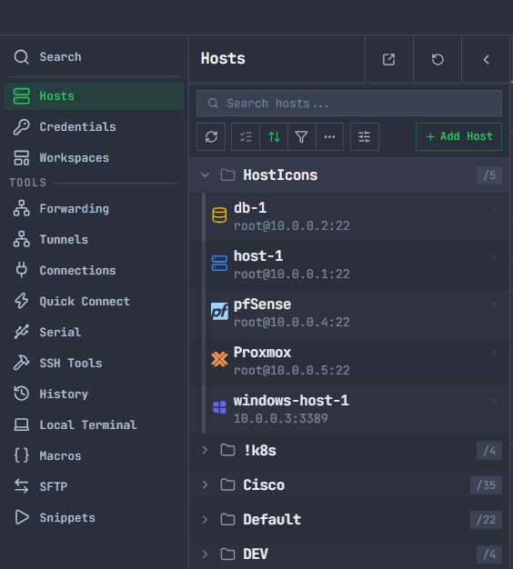
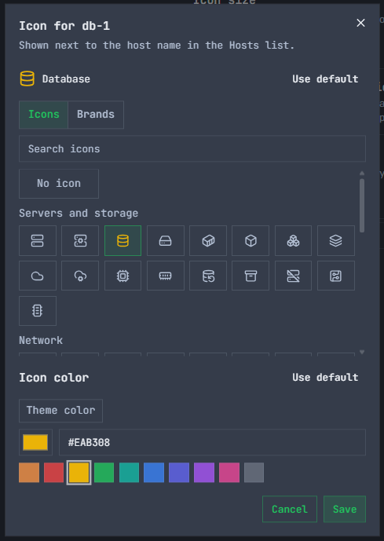
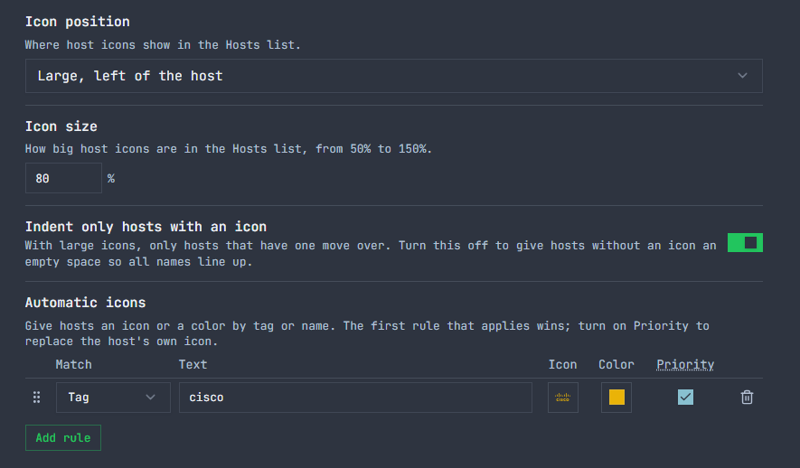

# Host Icons

A [Termix](https://github.com/Termix-SSH/Termix) plugin that gives each host in the Hosts list its own icon and color, so a database, a router and a Docker box are easy to tell apart at a glance.

<p align="center">
  
</p>

## Features

- An **Icon** and an **Icon color** field in the host editor, with a searchable picker of two packs: about 80 general icons (servers, storage, network gear, devices, security, development) and about 150 monochrome brand logos (Linux distributions, Proxmox, Docker, Kubernetes, databases, routers, NAS and more)
- **Text icons:** a label of up to 4 characters, such as DB or K8S, as a frame, a plate or plain text
- **Your own icons:** upload SVG or PNG files to a library shared with everyone, with permissions to upload and to manage (a chosen icon color paints them). The icons you upload sync to a linked desktop
- A large icon left of each host in the Hosts list, like in MobaXterm, or a small one before or after the name (**Icon position** in your settings)
- Defaults for a whole folder, for a user or for the whole server: hosts follow the default until they pick their own icon
- **Change icon** in the host's right-click menu and in the command palette for a quick change
- **Automatic icons:** rules that give hosts an icon, a color or a corner badge by tag, by name or by a regular expression on the name, in a table you reorder by dragging
- **Corner badge:** a 1 or 2 character label or a dot on the corner of the icon, with its own color, also available as a default
- **Icon size** from 50% to 150%
- English and Russian

<p align="center">
  
</p>

<p align="center">
  
</p>

## Install

Once the plugin is listed in the community registry: in Termix open **Plugins**, turn on the community registry under **Registries**, then find Host Icons in **Browse** and install it.

To install a build by hand, see [Development](#development).

## Use it

- **One host:** edit the host, open the **Host Icons** section, pick an icon and, if you like, a color. Save the host.
- **Quick change:** right-click a host in the Hosts list and choose **Change icon**.
- **A whole folder:** set Icon and Icon color in the folder's host defaults. Every host in the folder that has no icon of its own follows it. **Use default** in the host editor sends a host back to following the default.
- **By tag, name or regular expression:** under Settings, Host Icons, add rules such as "tag prod gets a database icon". The first rule that applies wins, and a host's own icon, color and badge win over a rule unless the rule takes priority. See the [docs](docs/index.md).
- **No icon:** pick **No icon**. **Theme color** makes the icon follow the text color.

## Limitations

- **Plugins can only add badges to a host row, and the Classic Layout draws them after the host name.** Host Icons moves its own badge with CSS: before the name for the small icon, and for the large one it also gives the row's text a left margin. The rule only matches rows that hold this plugin's icon. It relies on the Classic Layout's markup, not on an API, so if a Classic Layout update changes that markup the large icon falls back to the small one before the name until Host Icons is updated.
- With the large icon, only hosts that have an icon move over by default. Turn off **Indent only hosts with an icon** to give the others an empty space so all names line up.
- An empty icon means "no icon", so a host can't opt out of an automatic icon except by picking an icon of its own, and nothing can opt out of a rule with **Priority** on.
- The icon hides when **Plugin badges** is turned off under **Customize sidebar**, **Row details**.
- The general icons come from [Lucide](https://lucide.dev), the icon set Termix already ships. The brand logos are bundled with the plugin and drawn in one color, so they follow the icon color, not the brand's own colors. A brand that is not in the pack has no logo; use a general icon instead.
- Uploaded icons are shared by everyone on the server. SVG files are cleaned on upload (scripts, styles, images and external links are removed). Limits: 100 KB for an SVG, 256 KB and 512 by 512 pixels for a PNG, 500 icons and 10 MB in all.
- Logos that are mostly lettering (Cisco, VMware, macOS, iOS, Netgear, ASUS, Synology, QNAP, .NET, Plex) are no longer offered. Hosts that already use them keep them.
- People a host is shared with see the owner's icon. Only people who can edit the host can change it.

## Privacy

The plugin makes no network requests of its own and has no tracking or telemetry. Icons are drawn from the copy of Lucide inside Termix or from logo data bundled in the plugin, and the icon and color are stored as host settings by Termix itself. Uploaded icons are stored in the plugin's own database table. The capabilities it asks for are `ui:surface`, `db:own` and `network:serve` (the last two for the shared icon library).

## Development

You need Node 24. The full plugin guide ships with the SDK at `node_modules/@termix-ssh/plugin-sdk/PLUGIN-GUIDE.md`.

```bash
npm install
npm test
npm run typecheck
npm run validate
npm run build
npm run pack        # writes host-icons-<version>.tmxplug
```

To try it on a Termix server (26.10 or newer) you are an admin on, turn on **Plugin developer mode** under **Settings**, **General**, make an API key under **Settings**, **API keys**, then run:

```bash
npx termix-plugin dev --server http://localhost:30001 --key tmx_your_key
```

It builds, installs and reinstalls the plugin on every save. Reload the page to see frontend changes. You can also install the `.tmxplug` from **Plugins**, **Install from file**.

See [CONTRIBUTING.md](CONTRIBUTING.md) for the rest.

## License

MIT. See [LICENSE](LICENSE).

The brand logos are from [Simple Icons](https://simpleicons.org) (CC0) and [Tabler Icons](https://tabler.io/icons) (MIT), and are trademarks of their owners. See [NOTICE](NOTICE).
